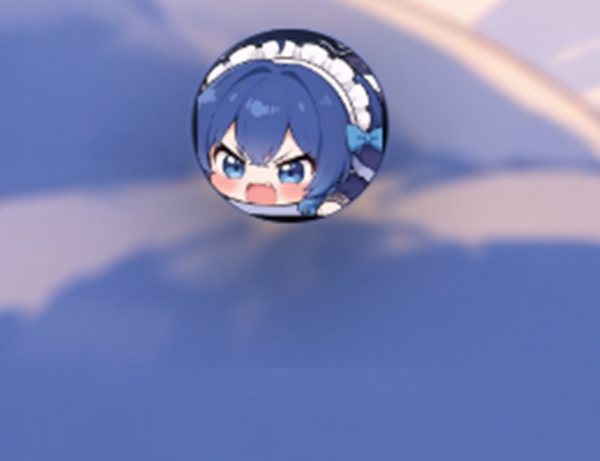
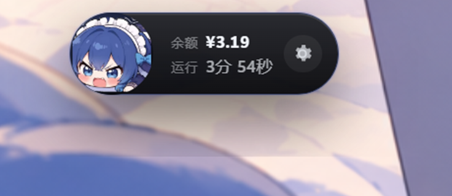
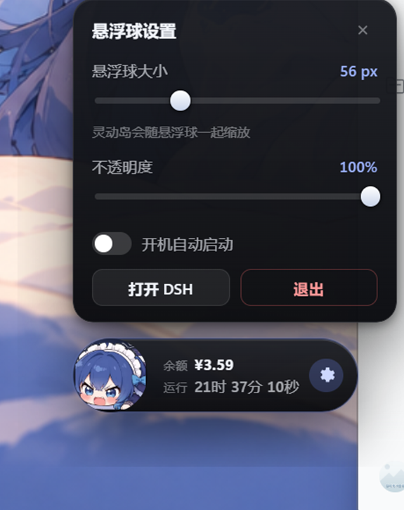

# DSH 悬浮球桌宠（dsh-floatball-pet）

> 由 [Riceyu02](https://github.com/riceyu02) 维护的第三方社区插件，与 DeepSeek 无隶属或合作关系。

一颗常驻桌面的**系统级悬浮球**：平时是小鲸鱼球，鼠标移上去向右展开成**灵动岛**——上面显示
DeepSeek 余额、下面显示 DSH 运行时长（精确到秒），最右边一个齿轮；点齿轮从上方升起设置面板，
拖滑块就能同时改悬浮球和灵动岛的大小。**单击悬浮球唤起 DSH 窗口**。

两种跑法：

- **DSH 插件（推荐）**：装进 profile，由 DSH 启动和回收；DSH 退出后悬浮球自动退出。
- **独立 Electron 程序**：DSH 关掉或最小化到托盘，悬浮球仍可独立运行。

| 待机 | 悬停展开灵动岛 | 点齿轮升起设置面板 |
|---|---|---|
|  |  |  |

## 功能

| 能力 | 说明 |
|---|---|
| **悬浮球** | 无边框、透明、置顶、不占任务栏；可拖动，位置自动记忆 |
| **灵动岛** | 鼠标移入向右展开（贴近屏幕右侧时改为向左） |
| **余额** | 实时读取 DeepSeek 余额，变化时数字高亮闪一下；悬停不额外请求 |
| **运行时间** | 精确到秒，每秒自增；DSH 未运行时显示「未运行」 |
| **设置面板** | 点齿轮从上方升起（贴近顶部时改为下方）；大小、不透明度拖滑块即时生效 |
| **唤起 DSH** | 单击悬浮球：DSH 在运行就把窗口拉到最前（最小化也还原），否则启动它 |
| **自定义图标** | 可换 GIF 动图或 PNG/JPG/WebP/BMP，一键恢复默认立绘 |
| **游戏让位** | 检测到游戏全屏 / 无边框全屏时自动隐藏，退出全屏立刻回来；浏览器 F11、播放器不会误判 |
| **托盘与自启** | 托盘菜单可显示悬浮球、打开 DSH、切换大小、退出；插件模式下的「开机自启」等于让 DSH 开机启动 |
| **版本更新** | DSH 设置 →「灵动岛悬浮球」里检查更新并一键升级（装完重启 DSH） |

## 安装：作为 DSH 插件

需要 Windows 10/11 与已安装的 DeepSeek Harness。下文 `dsh` 指桌面版自带的 CLI：

```text
<DSH 安装目录>\resources\runtime\cli\bin\dsh.cmd
```

它默认不在 PATH 上，用完整路径调用即可；`--profile desktop` 是桌面版实际使用的 profile，**不要改**。

> 本项目原名 `dsh-desktop-pet`，现已迁到
> [riceyu02/dsh-floatball-pet](https://github.com/riceyu02/dsh-floatball-pet)，旧仓库与旧包名不再维护。
> 装过 0.2.x 的需按下面任一方式重装一次。

装法就两条：

| 方式 | 适合 | 代价 |
|---|---|---|
| **方式一**（npm，插件页直接输入） | 大多数人；唯一能在插件页里直接装的方式 | 1.7 MB 的包，装时另下约 110 MB 的 Electron，要放行一次构建脚本 |
| **方式二**（Release 整包） | 发给别人，或离线 / 连不上 GitHub | 约 114.5 MB，装完即用；不下载、不放行 |

### 方式一：从 npm 装（推荐）

<https://www.npmjs.com/package/dsh-floatball-pet>

**插件页**：设置 → 插件 → 添加插件 → 输入 `dsh-floatball-pet` → 安装源选「中国大陆镜像源」→ 安装。
这个面板只有 npm 包名会走镜像源，GitHub 地址和 `.tgz` 直链都会绕过它。

**命令行等价**：

```powershell
dsh plugin --profile desktop add dsh-floatball-pet
```

第一次会停在**构建脚本**：包里的 `postinstall` 要在你机器上下载、校验、组装 Electron（约 110 MB），
pnpm 11 默认不放行。插件页点「允许这些脚本并重试」；命令行就把 pnpm 打印的那行加进
`<profile>\pnpm-workspace.yaml`（键是 `dsh-floatball-pet@0.1.0`）再跑一次。同一版本重装不再问。

装完**完全退出并重开 DSH**。

### 方式二：用 Release 整包

包名 `dsh-floatball-pet-<版本>.tgz`（当前 0.1.0，约 114.5 MB，内含运行时）。从
[Releases](https://github.com/riceyu02/dsh-floatball-pet/releases) 下载，或用别人发你的文件：

```powershell
dsh plugin --profile desktop add "<tgz 所在目录>\dsh-floatball-pet-0.1.0.tgz"
```

> 这个文件别放临时目录：profile 会把它记成 `file:` 路径，日后升级或重装还要回来找。路径建议全英文。

### 让 AI 帮你装

把这句话连同链接发给对方的 DSH：

> 帮我装 `dsh-floatball-pet`（npm 包），装进 `desktop` profile；需要放行构建脚本先问我，装完告诉我结果。

对方网络连不上 GitHub 时，直接把 tgz 发给他：

> 这是我给你的插件包 `dsh-floatball-pet-0.1.0.tgz`，帮我装进 `desktop` profile。

走应用内 `plugin_manager` 装的通常**当场生效**；退回命令行 `dsh plugin add` 的必须**完全退出并重开 DSH**。

### 装上了吗 / 卸载

装上后：`<profile>\package.json` 的 `dsh.profile.bundles` 里出现 `dsh-floatball-pet`；重启 DSH 后桌面
出现小鲸鱼球；日志与偏好在 `<profile>\data\dsh-floatball-pet\`（先看 `pet.log`）。

```powershell
dsh plugin --profile desktop remove dsh-floatball-pet
```

### 插件模式的行为差异

- DSH 启动时拉起悬浮球；插件卸载、禁用或 DSH 退出时关闭，不留孤儿进程。
- 偏好和日志在 `<profile>\data\dsh-floatball-pet\`，与独立模式互不干扰。
- 设置面板不显示「开机自动启动」——开机启动由 DSH 负责。
- 标准模式 5 秒内异常退出（沙箱起不来的机器）时，宿主会自动用 `--no-sandbox` 重试一次。

## 独立运行（不装成插件）

```powershell
git clone https://github.com/riceyu02/dsh-floatball-pet.git
cd dsh-floatball-pet
npm install
```

双击 **`启动悬浮球.cmd`**（等同 `npm start`）：先起焦点帮手，再启动 Electron；4 秒内异常退出会自动
换 `--no-sandbox` 重试。日志在 `%APPDATA%\DSH 悬浮球\pet-console.log`。

> **路径保持纯英文**：含中文等非 ASCII 字符时 Chromium 沙箱会初始化失败，表现为进程一闪就没、日志不写。

## 数据从哪来

**余额**按顺序尝试，失败自动降级，不会显示成 0：DSH 登录态（读 `$DSH_HOME/.credentials.yaml`）→
`DEEPSEEK_API_KEY` → 离线兜底（鲸鱼挂件账本里的上次观测值，标注「离线」）。启动时刷新一次，之后每
5 分钟一次；**只读**、只发往 DeepSeek 官方域名，不会改动 DSH 的任何凭据。

**运行时间**：TCP 连 DSH 的 Web 端口判断存活，再取 `DeepSeek Harness` 进程最早的 `StartTime`；
每 15 秒刷新，界面每秒重绘。

## 常见问题

| 现象 | 处理 |
|---|---|
| `npm install` 卡在 Electron 下载 | `$env:ELECTRON_MIRROR = "https://npmmirror.com/mirrors/electron/"; npm install` |
| 双击启动器什么都没发生 | 路径含中文，或本机沙箱起不来；改用插件模式（会自动重试兼容模式） |
| 日志说「找不到悬浮球运行时」 | 运行时没组装好：源码安装跑 `npm run pack`；插件安装若 pnpm 拦了构建脚本，放行后重装一次 |
| 单击悬浮球没反应 | 看 `pet.log` 的 `reason`；抢前台靠 `tools/focus-agent.cjs` 帮手，插件模式会自动拉起 |
| 悬浮球周围有一圈黑框 | 已知的透明窗口合成问题，当前实现已规避；复现请附系统版本与显卡驱动 |

## 致谢

- **[DeepSeek Harness](https://github.com/deepseekharness)** —— 插件系统、设置页 Slot、`webServer`
  路由与窗口生命周期都由它提供。
- 提 issue 与帮忙实测的朋友 —— 置顶闪烁、按 Win 键球不回来、拖动沉底、全屏切换卡死等修复都来自
  他们的实测数据，见 [CHANGELOG.md](CHANGELOG.md)。

## 许可证

原创代码 [MIT License](LICENSE)；Electron、Chromium 与美术素材的说明见
[THIRD-PARTY-NOTICES.md](THIRD-PARTY-NOTICES.md)。美术素材可随本应用及其插件包分发，但不属于 MIT
授权，也不授权脱离本应用单独复用。

## 运行时放在哪、什么时候下载

安装时组装（npm 走 `postinstall`，git 走 `prepare`，同一个脚本），落在**包外**的版本化缓存：

```text
<DSH_HOME>\dsh-floatball-pet\
├── downloads\              # 下载的 Electron 压缩包与解压结果，可整个删掉
└── runtime\<electron 版本>\ # 组装好的运行时，含 .ready.json
```

| 情形 | 会发生什么 |
|---|---|
| 全新安装 | 下载约 110 MB → SHA-256 校验 → 解压组装，约 10–40 秒 |
| 升级插件版本 | 缓存命中，什么都不做（实测 0.09 秒、零下载） |
| 换 Electron 版本 | 新版本单独一个目录，需再下一次；旧目录可删 |
| 装 Release 整包 | 包内 `runtime/` 优先，缓存不参与 |

下载源是 `cdn.npmmirror.com` → GitHub Releases，两边都用该版本的 `SHASUMS256.txt` 校验。要换源：

```powershell
$env:DSH_PET_ELECTRON_MIRROR = "https://your-mirror.example.com/electron/v{version}"
```

`{version}` 替换成 Electron 版本号；删掉整个 `<DSH_HOME>\dsh-floatball-pet\` 就会重新下载。

> 换版本后 DSH 会报 `restart-required`，重启即加载新代码，悬浮球不用退出。
